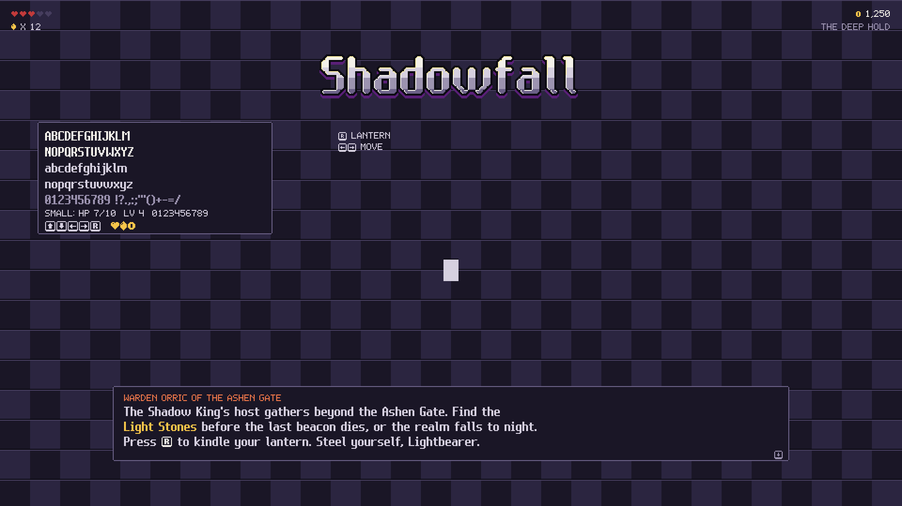

# Shadowfall fonts

Our own pixel font, drawn by hand for Shadowfall: no copied lettering. The glyphs are
text in `spikes/font/glyphs.py`. Rebuild everything here with:

    python spikes/font/make_font.py      # standard library only

## Sizes (native view 960×540, 32-px tiles, integer scaling, nearest-neighbour)

| Size | Use | Cap / x-height | Line (ascent + descent) | Files |
|---|---|---|---|---|
| **Body** | dialogue, menus | 10 / 7 px | 16 (12 + 4) | `shadowfall_body.png/.json`, `ShadowfallBody.ttf` |
| **Small** | HUD numbers, labels, key hints | 7 px, capitals only (lower case shows as capitals) | 10 (8 + 2) | `shadowfall_small.png/.json`, `ShadowfallSmall.ttf` |
| **Title** | "Shadowfall", big headings | 40 px (body ×4, bevelled corners) | 64 | `shadowfall_title.png/.json`, `shadowfall_logo.png` (288×74) |

Body has 2-px upright strokes and 1-px flat strokes, cut corners and pointed arches.
Digits are tabular in both sizes, so HUD numbers don't jump. The title sheet is
pre-coloured (shading, `ink0` outline, `shadow1` drop shadow): don't tint it.

## Characters

ASCII 32–126, plus game symbols in the Private Use Area (names in each JSON's `symbols`):

| Symbol | Code | Also on |
|---|---|---|
| heart | U+E000 | ♥ U+2665 |
| Light Stone | U+E001 | ◆ U+25C6 |
| coin | U+E002 | |
| key ↑ ↓ ← → | U+E010–E013 | ↑↓←→ U+2191, 2193, 2190, 2192 |
| key R | U+E014 | |

The title sheet has ASCII only.

## Using it

- **Sheets + JSON (any engine):** each glyph rect `x, y, w, h` is one line tall. Blit it with
  its top-left at `(pen_x, line_top)`, then `pen_x += advance + kerning.get(prev + ch, 0)`.
  Sheets are white on clear, so tint them. Title rects carry a `margin` (5 px): blit at
  `(pen_x - 5, line_top - 5)`, with no kerning.
- **TTF (pygame, Godot):** square-pixel outlines, 64 units per pixel. Use pixel size =
  line height (16 for body, 10 for small) or a whole multiple, with antialiasing off
  (pygame `render(text, False, ...)`; Godot: antialiasing None, hinting None, no
  subpixel positioning). It has a `kern` table with the same pairs as the JSON.
- Kerning: −1 px on about 140 letter pairs with wide gaps (`To`, `LT`, `Ay` and so on),
  found by a script. Digits and symbols are never kerned.

## Licence

Ours. Released under **CC0 1.0** (public domain), the default until the family picks another
licence (for example OFL 1.1). The TTF name table says the same.
