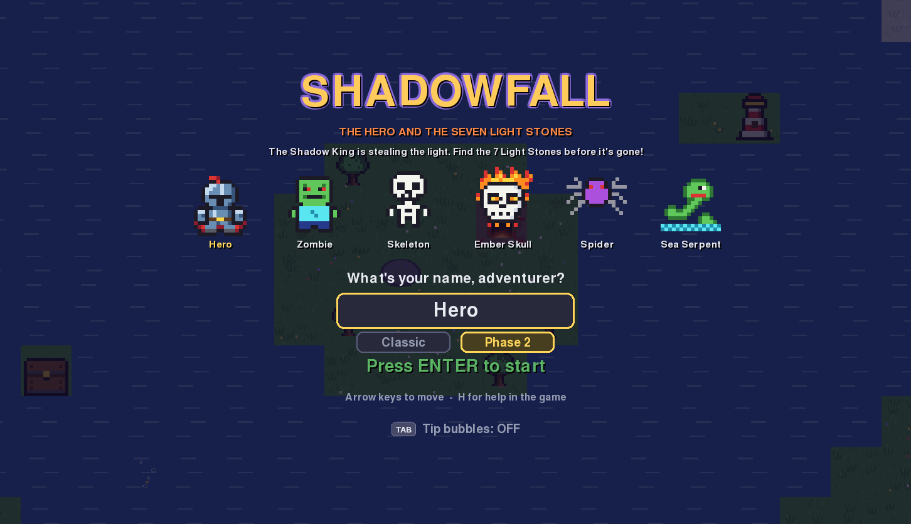
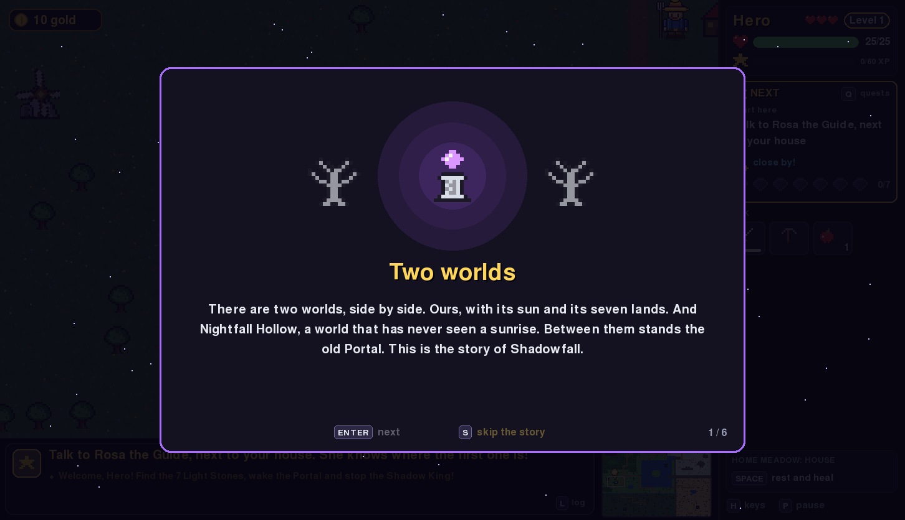
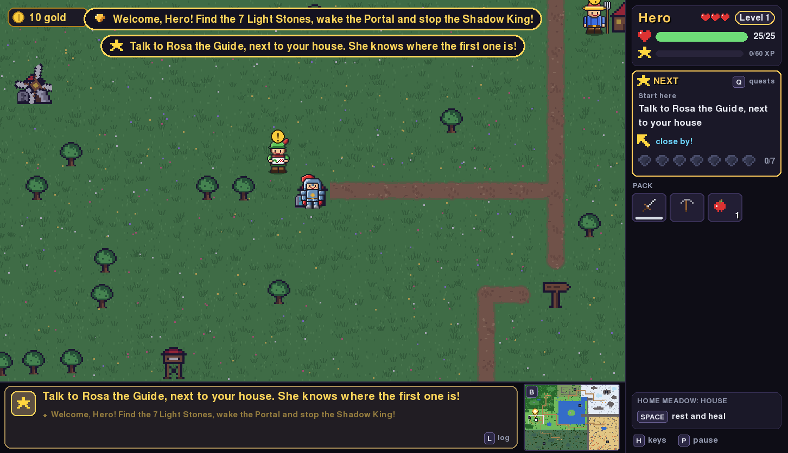
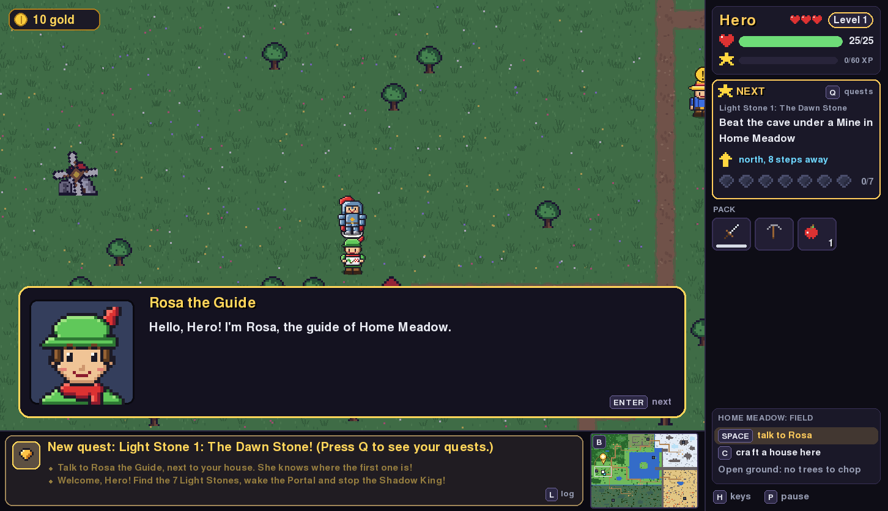
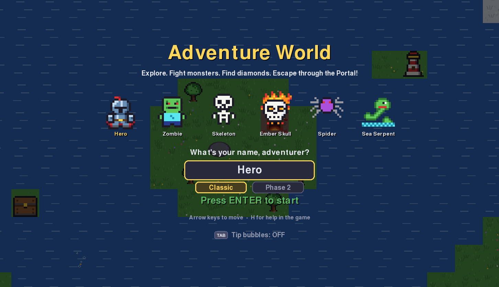
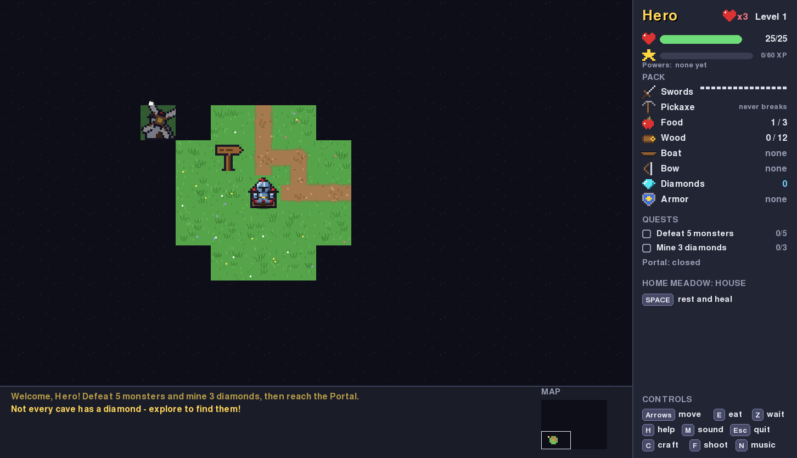

# Teen look (Phase 2)

Phase 2 is now called **Shadowfall**. It has a darker look, a dusk over the map, a darker map tune in A minor and a fuller story. Classic hasn't changed: shots 05 and 06 matched the old ones pixel for pixel. (The before shots were taken out when the repo went public.)

| | After |
|---|---|
| Title |  |
| First story card |  |
| Map + panel |  |
| Talk box |  |
| Classic title |  |
| Classic map |  |

To retake the after shots, run `python docs/teen-look/take_screenshots.py after`. To change the name or a colour, edit `phase2/theme.py`.
