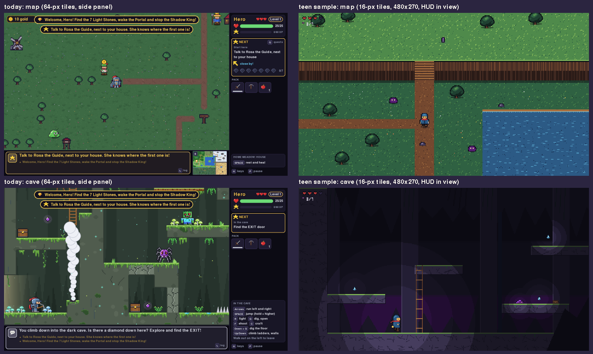

# Shadowfall teen art direction (Wave A, art)

**Pick:** chunky 16-px pixel art at **480×270**. Use one **32-colour palette** with tight per-sprite colour limits (the Shovel Knight rule), top-down depth from **light high ground, cliff faces and cast shadows** (the A Link to the Past rule), and caves built from **5 parallax layers with dark silhouettes and banded light pools** (the Hollow Knight rule). The world darkens through **4 gloom stages** in which each colour swaps to another palette colour. The game never fades smoothly. The whole style is plain PNG sprite sheets, so pygame and Godot can both use it.

*Left: today's game, shot headless (`spikes/art/shoot_today.py`). Right: code-made teen samples at the same size. The cave sample is meant to look sparser and darker. It shows layers and lighting, and has no decor pass yet.*

## 1. What the references teach (study only; nothing of theirs is in the repo)

| Game | Fact | Principle we take | Source |
|---|---|---|---|
| Shovel Knight | 400×240 virtual screen, 16×16 tiles, the NES tile count kept vertically. 16:9 with no bars | Low native resolution, scaled by whole numbers | [YCG: Breaking the NES](https://www.yachtclubgames.com/blog/breaking-the-nes/) |
| Shovel Knight | Sprites use 4–5 colours + clear (the NES allowed 3 + clear). 4 extra "cheater" colours were added to the NES palette | A hard colour budget per sprite, broken on purpose and only a little | same |
| Shovel Knight | 5–6 background layers on average. Palette cycling done in a shader. Invincibility shown by flashing, not alpha | Many parallax layers. Effects as palette swaps, not blends | same |
| A Link to the Past | 256×224. 8×8 / 16×16 tiles. 16 sub-palettes of 16 colours | Tiles share small sub-palettes, and each area gets its own set | [copetti.org SNES](https://copetti.org/writings/consoles/super-nintendo), [SFC wiki palettes](https://wiki.superfamicom.org/palettes) |
| A Link to the Past | The Dark World reuses the Light World layout with different tiles and colours. Ledges and walls do the gating | Our darkening world: the same map in a new palette | [tcrf](https://tcrf.net/A_Link_to_the_Past) (snippet), [Overworld overload pt 2](https://www.gamedeveloper.com/disciplines/overworld-overload-an-analysis-of-link-to-the-past-s-light-world-part-2) |
| Hollow Knight | Hand-drawn. "Keep it simple" so a big world could be built. Each area has its own look | One mood and one accent colour per area. Simple shapes | [Game Informer: Making of HK](https://www.gameinformer.com/2018/10/16/the-making-of-hollow-knight) |
| Hollow Knight | The hero reads as the brightest thing on screen, and the background is set back (fan analysis) | Value hierarchy: the play layer has the most contrast, back layers are darker and cooler | [Mechanics of Magic](http://mechanicsofmagic.com/2023/04/18/visual-design-of-games-hollow-knight/) |
| Pixel craft | An outline must raise contrast, never lower it. Use a dark outline, with black as the fallback | One-pixel ink outline on everything you can touch | [Lospec: outlines pt 2](https://lospec.com/articles/pixel-art-outlines-part-2-using-color) |

## 2. Style guide (the spec for Wave B)

| Topic | Rule |
|---|---|
| Resolution | Native **480×270**, integer-scaled (×2 960×540, ×3 1440×810, ×4 1080p). Nearest-neighbour only. The camera snaps to whole pixels |
| Tile | **16×16**. Overworld view 30×17 tiles. Cave view the same. One level-file cell = one tile |
| Palette | **Shadowfall 32** ([palette.png](palette.png), `spikes/art/sf_art.py`). No colour outside it, ever. Ramps: ink `0b0a12 1a1626 2b2540 463d5e 6b6187 9c93b0 d6d0e0 f4f1ea` · moss `12261f 1f4031 2f6142 4f8a4b 8bbd5a` · earth `2a1b17 4a2f25 74482f a8703f d9a95f` · water `0f1d33 1b3557 2c5a85 4a8fb8 8fd0e0` · ember `3d0f1f 7a1c2e c23a3a f0784a` · light `f7c64a fff2a8` · shadow `2a0f3d 5a1f78 a04ce0` |
| Colour budget | Tile: ≤4 colours. Character: ≤6 + outline. Boss: ≤8 + outline. Area: ≤12 colours + **1 accent** (Meadow gold, Forest moss, Lake water, Peaks ink-white, Desert ember, Swamp shadow, Nightfall violet) |
| Outline | 1 px `ink0` around anything you can touch (Hero, monsters, people, pickups, chests). Tiles and backgrounds get **no** outline. Back layers never use `ink0` |
| Shading | Light from the top-left. 3 steps (shadow, base, light) + an optional 1-px highlight. Shadows shift toward violet/blue and lights toward warm. No dithering on sprites. Dithering only at the seams of a sky or void gradient (a 4-row checker) |
| Top-down depth | High ground is one ramp step lighter, with a lit lip row. Cliff faces are 2 tiles tall and darker going down. A 4-px cast shadow sits under each cliff. A flat dark oval goes under each standing thing. Draw order is y-sorted ([overworld_tiles.png](overworld_tiles.png)) |
| Sprite sizes | Hero top-down 16×24 · Hero side 24×32 · people 16×24 · small monster 16×16 · big monster 32×32 · mini-boss 48×48 · **Shadow King 96×128** · pickups 8×8 or 16×16 · portraits 48×48 |
| Frames (fps) | idle 2–4 (4) · top-down walk 4 per direction (8) · side run 6 (12) · jump 3 (rise, apex, fall) · attack 3–4 (anticipation 1, strike 1, follow 1–2) · hurt 2 (flash, no alpha) · death 6 · water/torch tiles 2–4 (4) |
| Sheets | One PNG per character: rows = animations, columns = frames, a fixed cell size, transparent background, plus a `.json` with name → row, frames, fps. Left = right flipped, except for asymmetric props. These load the same way in pygame and in Godot (AtlasTexture / SpriteFrames) |
| Parallax (caves) | 5 layers ([cave_layers.png](cave_layers.png)): far void 0× (gradient) · back rock 0.25× (`ink1` silhouettes) · mid 0.5× (`ink2` pillars, roots) · **play 1×** (the only layer with lit edges, moss and the full value range) · front 1.4× (solid `ink0` silhouettes, ≤15% of the screen). Overworld: no parallax, only drifting cloud shadows at 1.1× (optional) |
| Lighting | Draw darkness (`ink0` at about 75% alpha) over the world. Light pools cut it in **3 hard rings** (100/72/45% of the radius), and overlapping pools merge by taking the lowest darkness. Hero lantern radius 130 px, crystals 30–40. The HUD is never darkened ([cave_scene.png](cave_scene.png)) |
| Darkening world | **4 gloom stages** ([darkening.png](darkening.png)). Each stage moves every world colour one step down its own ramp. At stage 3, moss/earth/water drop into the ink ramp. Accents (light, ember highs, shadow) never change. Characters are **not** remapped, so they always read. Stage 3 adds the lantern pool. In pygame this is a lookup table (LUT) applied to the tiles when they are cached. In Godot it is a palette-swap shader. Map game `gloom` 0–1 to stages 0/0.33/0.66/1 |
| HUD | Inside the play view, no side panel. Top-left: hearts (7×6), the light-stone count. Top-right: gold. A 3-line text box only when someone talks. Frame: `ink1` fill, `ink4` 1-px border, `light0` for the important word. Quest and map go on a pause screen |
| Fonts | A pixel font at 1× native: **5×7** for body text and **3×5** for numbers (a 3×5 demo is in `scenes.py`). Make our own (default, no licence risk), or use an OFL/CC0 pixel font after checking its licence |
| Shadow King | Always a silhouette (`ink0`). Two `shadow2` eyes and a `shadow1` orb are his only colour. A rim light from behind (`ember1/2`). Smoke motes rise off him. He is never gory ([shadow_king.png](shadow_king.png)) |
| Kid-safe | Dark, not gory: no blood, and defeated monsters burst into smoke. Danger reads as violet/ember with bright eyes |

Samples ([hero.png](hero.png), engine-ready sheets [hero_topdown_16x24.png](hero_topdown_16x24.png) and [hero_side_24x32.png](hero_side_24x32.png)). Rebuild all of them: `python spikes/art/shoot_today.py && python spikes/art/make_samples.py`.

## 3. Wave B asset list (one artist per row; each owns only `assets/<folder>/`)

| # | Folder | Contents (size × frames) | Size of job |
|---|---|---|---|
| A1 | `assets/hero/` | top-down 16×24: idle 4×4 dirs, walk 4×4, attack 3×4, hurt 2, lantern-raise 3 · side 24×32: idle 4, run 6, jump 3, fall 1, land 2, attack 4, air-attack 3, climb 4, dig 4, hurt 2, death 6 | L |
| A2 | `assets/people/` | 12 townsfolk 16×24 (idle 2, walk 4×4) · 8 portraits 48×48 (2 expressions each) | L |
| A3 | `assets/monsters_map/` | 7 overworld monsters (one per land) 16×16 or 32×32: move 4, attack 3, hurt 2, poof 4 | M |
| A4 | `assets/monsters_cave/` | 10 cave monsters 16×16–32×32 (crawl/fly 4, attack 3, hurt 2, poof 4) · 3 mini-bosses 48×48 (6 animations) | L |
| A5 | `assets/boss/` | Shadow King 96×128: idle 4, float 4, cast 6, summon 6, hurt 2, fade-out 8 · his shadow hand 32×32 (4) · orb FX 16×16 (4) | M |
| A6 | `assets/tiles_world/` | per land (7): ground ×3, path ×3, water 2-frame + shore 16-piece autotile, cliff top/face/corners (13), trees 2 (24×32), rocks 3, bushes 2, props 8 (signs, fences, houses 48×48, waystone, mine entrance 32×32) | XL, split by land (A6a–A6g) |
| A7 | `assets/tiles_cave/` | per cave theme (5: stone, frost, sand, swamp, shadow): solid 16-piece autotile, platform 3, ladder, spikes, door, chest 2-frame, crystal 2, decor 10 · parallax layers 0.25× / 0.5× / 1.4× (480×270, 1 tile-able strip each) | XL, split by theme |
| A8 | `assets/castle_throne/` | castle tiles (16-piece + 12 props), throne room 3 parallax layers, sky gradient | M |
| A9 | `assets/ui/` | HUD hearts, stone, gold, the 9-slice text box, key prompts 12×12, pause/map screen frame, title logo "Shadowfall" (≤240×60), 5×7 + 3×5 fonts as a PNG grid + JSON | M |
| A10 | `assets/fx/` | hit spark 4, dust 4, smoke poof 4, lantern pool rings, light-stone glow 4, gloom LUT PNG (32×4 strip, one row per stage) | S |

Shared rules for every artist: the palette PNG comes from A10 and is read-only to everyone else, plus the sheet `.json` format above. Check each sheet with a script that fails when a colour is off-palette or a cell is the wrong size. That check should be Wave B's first task, done before the art.

## 4. Open questions for the user
1. **Scale:** is 16-px chunky pixel art right (the samples), or do you want finer 32-px tiles (more detail, about 4× the art work)?
2. **Hero:** keep the blue-and-red colours but change from the knight to the hooded wanderer with a lantern? (The lantern ties into the lighting and the darkening.)
3. **Darkness:** is gloom stage 3 in [darkening.png](darkening.png) too dark for your kid?
4. Make our own pixel font (the default), or use a free one?

## 5. Not verified
- Hollow Knight's parallax layer count, its lighting and vignette, and its HUD: no developer source found. The row above relies on fan analysis. Whether A Link to the Past uses SNES Mode 1 is unchecked, and its Dark World palette intent has no developer source.
- The samples were checked only by eye. Not tested: in-engine speed of the LUT or lighting, or how the Hero looks in motion (no animated preview was made).
- The Hero is 2 tiles tall in caves (24×32), while today's caves assume about 1 tile. The gameplay/levels workers must confirm jump and gap sizes.
- No font licences were checked.
