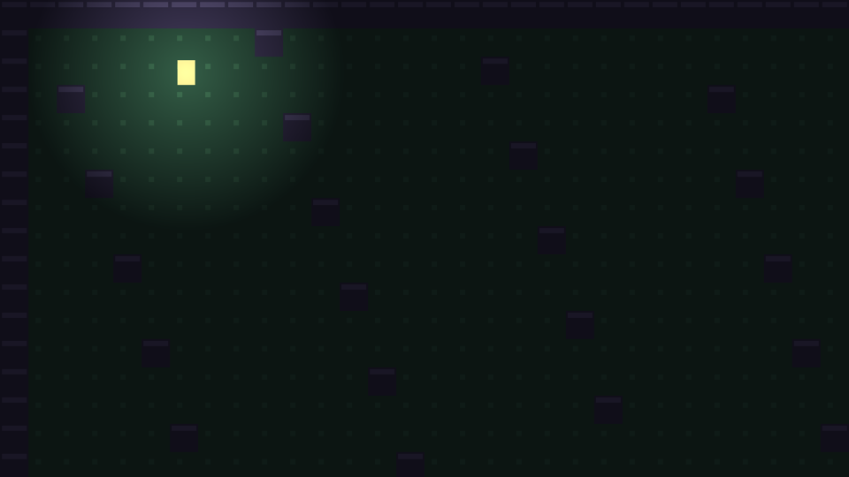

# Shadowfall teen refactor: which engine (Wave A, engine)

**Pick: Godot 4.7 (2D, Compatibility renderer, GDScript).** pygame can be made smooth, but on the web it runs out of headroom. Godot gives us tilemaps, platformer physics, slopes, 2D lights and shaders, and an editor without extra work. Its web export is steadier than pygbag's. The kid keeps drawing caves as text files: Godot reads `levels/` as it is.

Spikes: `spikes/engine/pygame/` and `spikes/engine/godot/`. Each has the same top-down walk with an easing camera, a side-view jump (coyote 0.10 s, buffer 0.10 s, short hop) and a dark layer with a light around the hero. The numbers are the same in both, with 32-px tiles at a 960×540 game size. All raw numbers are in `bench.json`.



## 1. Measured (2026-11-21, M3 Pro Mac, a robot plays 10 s per scene)

| Run | mean ms | stdev ms | p99 ms | late >20 ms | CPU per frame |
|---|---|---|---|---|---|
| pygame, **as `game.py` runs today** (no `SCALED`, `Clock.tick(60)`) | 16.94 | 0.46 | 17.8 | 0 | 2.2 ms |
| pygame, `SCALED` + `vsync=1`, smooth full-res camera | 8.33 (120 Hz) | 0.39 | 9.6 | 0 | 3.0 ms |
| pygame, `SCALED` + `vsync=1`, 960×540 ×2 (whole-pixel camera) | 16.67 | 0.26–1.29 | 19.1 | 4 | 1.3 ms |
| Godot desktop, vsync, no cap | 8.8 | **4.6** (uneven) | 16.8 | 1–2 | n/a |
| Godot desktop, vsync + `max_fps=60` | 16.67 | 0.61 | 17.6 | 1 | n/a |
| **pygbag web** (Chrome) | 16.00 (62.5 fps, not synced) | 0.45 | 17.0 | 0 | **7.6–8.0 ms** |
| **Godot web** (Chrome) | 8.33 (120 Hz, synced) | 0.44 | 9.4 | 0 | n/a |

What the numbers say:
- **Both engines can pace frames well on desktop**, but only when set up right. pygame applies `vsync=1` only with `SCALED` or `OPENGL`. Today's `game.py` has neither, so `Clock.tick(60)` (whole milliseconds) gives 59 fps and a repeated frame about once a second. That is a hitch in T4's smooth walk; the fix is one line (see Open questions). Godot without an fps cap was uneven on the variable-refresh screen. With `max_fps=60` it was steady.
- **The web decides it.** pygbag spent **8 ms of the 16.7 ms frame** on just a tilemap plus one light, about 3× desktop, on a fast Mac. Add parallax layers, particles, monsters and a full-screen dark pass, then run it on a school Chromebook, and pygbag will drop frames. Its loop also runs at 62.5 fps, not locked to the screen. Godot's web build draws on the GPU (WebGL 2), stays locked to the screen (stdev 0.44 ms) and leaves the CPU nearly idle.
- Downloads: Godot web is 10.3 MB zipped (40 MB unzipped, 10 MB wasm gzipped). pygbag's first load was 23 MB, mostly the Python runtime and pygame-ce from the pygame-web CDN, which must stay online.

## 2. Comparison

| | pygame-ce + pygbag (now) | **Godot 4.7** | Defold (third; not spiked) |
|---|---|---|---|
| Smooth scrolling | CPU blits; smooth sub-pixel camera means drawing at full res (cost above) | GPU; `canvas_items` stretch moves the camera smoothly at sub-pixel steps; physics interpolation | GPU; good |
| Camera | write it (easing, limits, shake) | `Camera2D`: smoothing, limits, drag margins | write or use a library |
| Tilemaps | write it; we have our own | `TileMapLayer`: collision per tile, terrains, painting | built-in tilemap editor |
| Platformer physics | write it (`feel.py`, 120 lines, **no slopes**) | `CharacterBody2D.move_and_slide`: floors, **slopes passed the test**, one-way platforms | write it or use a library |
| Dark look / lights | multiply a mask yourself (CPU, full screen every frame) | `CanvasModulate` + `PointLight2D` + shadows + shaders, all working on web (checked) | shaders: yes; 2D lights: write them |
| Audio | mixer; web needs .ogg; our math music is pre-rendered for web | buses, effects, low-latency sample playback on web | good |
| Web build for itch.io | works today; runtime from a CDN; slow CPU | single-thread export, no special headers, 10 MB zip; **checked running** | good HTML5, ~5 MB (forum figure) |
| Headless tests / CI | pytest, 656 test functions, robot solver | `godot --headless` scripts (spike: 3 checks pass); gdUnit4 for real suites | weaker |
| Level editor | `editor.py` + `levels/*.txt` | Godot's tile painter **and** our text files (loaded at run time, as in the spike) | its own editor |
| Parent + kid | Python, known | GDScript reads like Python; visual editor; the phase-3 prototype already exists; Orca highlights `.gd` | Lua, smaller community |
| Port cost | 0 engine cost, but the teen rewrite rewrites most gameplay anyway | rewrite the code (about 25k lines of Python today); content moves unchanged | same as Godot, smaller community |

LÖVE was dropped as the third option: its web port (love.js) only supports 11.5 and calls itself a work in progress.

## 3. Findings from the references (study only, nothing copied)
| Reference | Engine-relevant point | Source |
|---|---|---|
| Shovel Knight | a low fixed game size and a steady 60 fps; a game that looks retro but drops NES limits where they hurt feel | https://www.gamedeveloper.com/design/breaking-the-nes-for-shovel-knight |
| Hollow Knight | made in Unity: a GPU engine with lights, particles and an eased camera made the dark, smooth feel affordable for a small team | https://en.wikipedia.org/wiki/Hollow_Knight |
| A Link to the Past | screen-sized rooms with a scrolling camera; on 16-px tiles, 8-way walking still reads cleanly | https://en.wikipedia.org/wiki/The_Legend_of_Zelda:_A_Link_to_the_Past |
| Godot web docs | single-thread export is the default; web uses Compatibility (WebGL 2); sample audio is low latency | https://docs.godotengine.org/en/stable/tutorials/export/exporting_for_web.html |
| Godot 4.3 web report | single-thread export fixed Apple devices and audio | https://godotengine.org/article/progress-report-web-export-in-4-3/ |
| pygame display docs | `vsync=1` only with `OPENGL` or `SCALED`, experimental | https://www.pygame.org/docs/ref/display.html |
| pygbag wiki | the loop must be async; .ogg only | https://pygame-web.github.io/wiki/pygbag |
| gdUnit4 CI | headless Godot tests in GitHub Actions | https://github.com/MikeSchulze/gdUnit4-action |
| love.js | supports LÖVE 11.5 only, a work in progress | https://github.com/2dengine/love.js |

## 4. Spec for Wave B (if Godot is picked)
**Settings:** Godot 4.7.x, `gl_compatibility`, viewport 960×540, stretch `canvas_items` (smooth camera; pick `viewport` for a strict pixel grid), nearest texture filter, physics 60 Hz with `physics_interpolation=true`, `Camera2D` with physics process, `max_fps=60` on desktop, single-thread web export. Feel numbers (32-px tiles), the same in both spikes: walk 160 px/s (5 tiles/s); run 192 px/s; gravity 1960; jump 600 (about 2.9 tiles); jump cut ×0.45; coyote 0.10 s; buffer 0.10 s; hero box 20×28 in the spike (Wave B sizes it to the 48×64 sprite).

**Layout:** a new folder `shadowfall/` (a Godot project) on `phase-2`. The pygame game stays playable until the new one matches it, then gets retired. `levels/` and `phase2/data/*.json` stay where they are, and Godot reads them through `res://` symlinks, or a copy made at export time (B0 picks).

| # | Worker task (owns only these files) | Depends on |
|---|---|---|
| B0 | Scaffold: `shadowfall/project.godot`, autoloads `Game` (state, save), `Scenes` (switching), input map (R attacks), CI: a headless test job + web export in `build-web` with cached export templates, itch.io upload | none (go first) |
| B1 | Overworld: `world/` (TileMapLayer from `levels/world/*.txt`, top-down hero, camera, waystones, map monsters) | B0 |
| B2 | Caves (platformer): `caves/` (loader for `levels/caves/*.txt`, side hero with coyote/buffer/slopes, cave monsters, hazards) | B0 |
| B3 | Dark and light: `light/` (gloom 0 to 1 from `phase2/gloom.py` rules, CanvasModulate, lights, Light Stones, shaders) | B0 |
| B4 | Rules and data: `rules/` (stats, crafting, quests, shop, dialogue from `phase2/data/*.json`) plus unit tests | B0 |
| B5 | UI: `ui/` (HUD, dialogue box, menus, quest log, pause, title) | B0, B4 API |
| B6 | Audio: `audio/` (buses, music and SFX from the audio worker's spec) | B0 |
| B7 | Kid's editor: keep `editor.py` writing the same `.txt` format (add new tile letters), adapt `cave_solver.py`, add a `pixi run` task to play a cave in Godot | B2 legend |
| B8 | Castle + Shadow King: `boss/` | B2 |
| B9 | Integration, balance, the playthrough robot | all |

Rough size: B0 alone, then **6–7 workers in parallel** (B1–B8), then B9. That makes about 10 worker tasks over three waves.

## 5. Open questions for the user
1. **Engine: Godot (my pick) or stay on pygame?** If pygame: switch desktop to pygame-ce (desktop runs pygame 2.6.1 today but the web build uses pygame-ce 2.5.7), use `SCALED` + vsync, and expect to cut effects on the web.
2. Should I fix today's hitch now? It's one line in `game.py` (`pygame.SCALED`, `vsync=1`, and `Clock.tick` only as a fallback). It needs a small PR from whoever owns `game.py`.
3. Camera style: smooth sub-pixel (`canvas_items`, my pick, as Hollow Knight does) or a strict pixel grid (`viewport`, crisper but steppier)?
4. Should the itch.io page switch to the Godot build at parity, or should both live side by side for a while?

## 6. Not verified
- No Windows, Linux, Chromebook, Safari or iOS runs: only Chrome on an M3 Pro Mac. Frame times depend on the screen (120 Hz vs 60 Hz). No uploads to itch.io (the page stays Restricted).
- No Defold spike, and its numbers come from the docs and the forum. Godot audio latency on the web and gdUnit4 in CI were not tried.
- Godot export templates: I installed only the web templates into `~/Library/Application Support/Godot/export_templates/4.7.2.stable/` (the full download is 1.3 GB). CI will need them cached.
- The reference rows for the games are general knowledge with a source link, not measured.
- pygbag gotcha found: `import statistics` makes it fetch a PyPI package and hang. The spike avoids that module.

## Run the spikes
```
<pixi python> spikes/engine/pygame/main.py [--bench] [--pixel] [--vsynconly|--busy]
<pixi python> -m pytest -q -p no:xdist spikes/engine/pygame        # 6 feel checks
godot --path spikes/engine/godot [-- --bench [--fps60] | --shots]
godot --headless --fixed-fps 60 --path spikes/engine/godot -- --test   # coyote, no late jump, slope
godot --headless --path spikes/engine/godot --export-release Web <dir>/index.html
```
