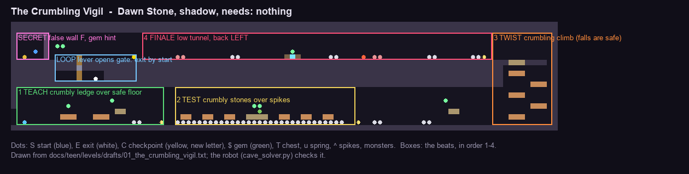
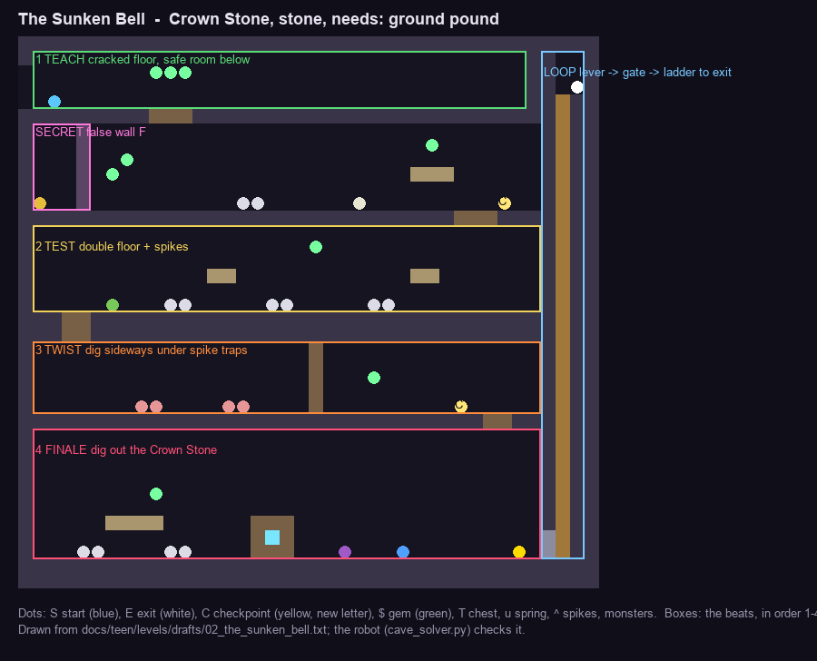
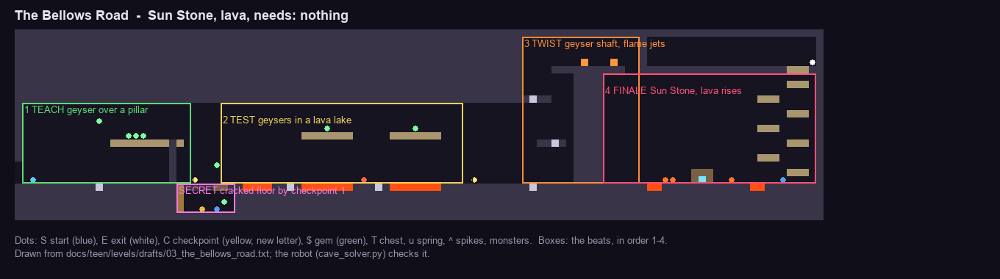

# Wave A, levels: the overworld and caves for teen Shadowfall

Worker W-A4, 2026-11-21. These are proposals. Wave B builds them after the user picks the engine.
Everything here is original. The reference games were studied only through the linked pages and map images, and none of their art, names or layouts is in this repo.

**Contents:** [overworld.png](overworld.png) · cave sketches [cave_01.png](cave_01.png), [cave_02.png](cave_02.png), [cave_03.png](cave_03.png) · drafts in [drafts/](drafts/) (today's format plus `C`) · `spikes/levels/draw_levels.py` (draws the figures) · `spikes/levels/check_drafts.py` (runs the cave robot on the drafts).

## 1. What the references teach

| # | Finding | Source |
|---|---|---|
| 1 | A stage is about **26 screens plus 6 secret screens**, and every stage takes about the same time. One screen is one room. | [Kotaku on Shovel Knight](https://kotaku.com/how-shovel-knights-developers-modernized-nes-game-desig-1829767941), [YCG deep dive 1](https://www.yachtclubgames.com/blog/specter-of-torment-level-design-deep-dive-1-5) |
| 2 | About **5 enemies and 5 objects per stage**, each reused. No idea is used only once. | [deep dive 1](https://www.yachtclubgames.com/blog/specter-of-torment-level-design-deep-dive-1-5) |
| 3 | **Teach, test, twist.** Teach an idea safely after a room change, test it over a pit, then twist it. The last part mixes everything. Each room ends harder than it starts, followed by a cool-down. | [deep dive 2](https://www.yachtclubgames.com/blog/specter-of-torment-level-design-deep-dive-2-5) |
| 4 | Checkpoints activate when you walk past them. Breaking one pays gems, but you lose it as a respawn (risk and reward). Put healing near it, off the main path. | [checkpoint design](https://www.yachtclubgames.com/blog/check-point-design), [deep dive 3](https://www.yachtclubgames.com/blog/specter-of-torment-level-design-deep-dive-3-5) |
| 5 | Every secret wall gets a visible hint, and gems lead the eye. Secret routes branch near the **halfway checkpoint**. | [deep dive 4](https://www.yachtclubgames.com/blog/specter-of-torment-level-design-deep-dive-4-5), [secret paths](https://www.yachtclubgames.com/blog/knight-knight-s-map-building-secret-paths) |
| 6 | The overworld is a **grid of screens** (8 × 8 per world). Each region has its own terrain colour, and one big landmark sits in the middle. | [Overworld analysis](https://www.gamedeveloper.com/disciplines/overworld-overload-an-analysis-of-link-to-the-past-s-light-world-part-2), [map image](https://www.vgmaps.com/Atlas/SuperNES/LegendOfZelda-ALinkToThePast-LightWorld.png) |
| 7 | Item gates are **few, specific and visible** long before you can open them. Some items only open shortcuts. The map is mostly open, with a few chokepoints. | same analysis |
| 8 | The second world has the **same footprint with different terrain**. "Same spot, other world" works as a puzzle. | [Dark World](https://zeldawiki.wiki/Dark_World), [map image](https://www.vgmaps.com/Atlas/SuperNES/LegendOfZelda-ALinkToThePast-DarkWorld.png) |
| 9 | Hand-place the world first, then the critical path. Areas are long corridors joined by shafts, with several ways in. | [HK devs on mapping](https://gamedeveloper.com/design/how-the-i-hollow-knight-i-devs-mapped-out-their-metroidvania-), [area map](https://cdn.wikimg.net/en/hkwiki/images/4/4d/Crystal_Peak_Map.png) |
| 10 | The map is bought or found **per area** and updates at a rest point. Secret walls never show on it. | [Cornifer](https://www.hollowknight.wiki/w/Cornifer), [Map](https://hollowknight.wiki/w/Map) |
| 11 | Early on, the next lock is "just around the corner". Later, one ability opens many locks. Each area has one gimmick and one colour. | [GMTK world design](https://gmtk.substack.com/p/the-world-design-of-hollow-knight) (written about Silksong) |

## 2. Recommendation: 15 level rules for Shadowfall

| Rule | Number / test |
|---|---|
| **R1 One idea per cave.** Teach, then test, then twist, then a finale that mixes in one earlier idea. | ≤ 5 hazard kinds and ≤ 3 monster kinds per cave |
| **R2 Teach on safe ground.** The first use of an idea has no damage under it. | robot plus a human check |
| **R3 Sections are screens.** One beat is about 1 screen: 30 × 17 tiles of 32 px, a 960 × 540 view (the user's 32-px pick). Leave ≥ 4 flat tiles at the start and end of every section. | Stone cave = 4 sections ≈ 100–150 × 20–40 tiles (3–5 screens wide) |
| **R4 Checkpoints `C` between sections.** Put a spring `u` or a gem cache near each one, off the path. | 2–3 per Stone cave, 0 in side caves |
| **R5 Loop home.** Every Stone cave ends next to its entrance, through a lever and gate (works today) or a one-way door. | exit ≤ 12 tiles from `S` |
| **R6 Every cave has ≥ 1 hinted secret.** Use a gem trail, a cracked `B` or a visible ledge. Never use an unhinted `F`. Put it near a checkpoint (the halfway one in Stone caves). | ≥ 1 per cave |
| **R7 Gems lead the eye.** Use more gems early and fewer late. | ~1 gem per 6 columns in section 1, half that in section 4 |
| **R8 Length by robot time.** The robot (`cave_solver.py`) must beat every cave. | Stone cave 30–60 s robot (a human takes about 2–4 min), side cave ≤ 25 s |
| **R9 The robot's physics rules still hold** (`levels/README.md` "Tips"). | jump ≤ 2; hazards in low tunnels ≤ 2 wide |
| **R10 The overworld is a grid of screens.** Each screen has one landmark or one idea, and each land has its own colour and hazard. | 6 × 5 screens × 30 × 17 = 180 × 85 tiles = 5760 × 2720 px (today about 111 × 83 tiles) |
| **R11 Each Light Stone gives one ability.** It opens **one** main gate and ≥ 1 shortcut or secret elsewhere. | 7 Stones, 6 gate kinds plus Moonsight |
| **R12 Gates are seen before they open.** The player meets each gate at least one land before its Stone. | check on overworld.png |
| **R13 The Portal is the centre landmark.** The main route spirals round it. | Portal at D3, visible from 8 screens |
| **R14 One waystone per land, at its entry hub.** It also reveals that land's map, secrets excluded. The Stone cave is ≥ 2 screens from the waystone. | 7 waystones |
| **R15 Nightfall Hollow mirrors the centre.** Same footprint as screens C2–E4 (3 × 3), with different terrain. | 9 screens, 3 shadow caves, then the castle |

## 3. The overworld (figure: [overworld.png](overworld.png))

```
      A            B            C            D            E            F
 1  Woods(2)?   Woods       | Ruins      Ruins(3)   # Frost        Frost(5)
    ==lantern== Queen Oak  climb Watchtower  ###wall###  Frost Peak
 2  Woods       Hearthvale  | Ruins     pound Lake(4) sail Frost      Frost
                                          ~~~~~~~~~~~~~        ...frostward...
 3  Home(1)     HOME        Lake shore  sail PORTAL   Lake       frost| Desert
    ~~sunflare~~ ~sunflare~ ~~~sail~~                Lighthouse
 4  Swamp       Swamp  sunflare| Lake    Lake      frost| Desert    Desert(6)
                           ~sunflare~ ~~frostward~~
 5  Swamp(7)    Swamp       Swamp  sunflare| Desert  Dragon Bones  Desert ?
       (n) = Light Stone cave n     | or ~~ = a gate on that edge     ? = secret
```

| Order | Land (screens) | Light Stone → ability | Main gate it opens | Also opens (shortcuts and secrets) | Cave gimmick |
|---|---|---|---|---|---|
| 1 | Hearthvale, the home meadow (A3 B2 B3) | Dawn → **Lantern** | Deepwood (A1) is pitch dark | dark corners of caves (`dark: yes`) | crumbly ledges: **draft 1** |
| 2 | Whispering Woods (A1 A2 B1) | Leaf → **Climb** | ivy cliffs up to the Ruins plateau | cliff drop Ruins → Home; `%` walls | vines, swings, the dark |
| 3 | Old Ruins (C1 C2 D1) | Crown → **Pound** | rubble on the causeway to the north shore | cracked `B` walls in every cave | cracked rock: **draft 2** |
| 4 | The Great Lake (C3 C4 D2 D4 E3) | Tide → **Sail** | open water: east shore and Frost Peaks | Lake → Home ferry; island chests | moving platforms over water |
| 5 | Frost Peaks (E1 E2 F1 F2) | Frost → **Frostward** | the heat of Sunscorch (all its edges) | frozen ponds in the Swamp | ice and wall jumps |
| 6 | Sunscorch Desert (D5 E4 E5 F3 F4 F5) | Sun → **Sunflare** | the thorns round the Murk Swamp | thorn path in the Woods; Nightfall beacons | geysers and fire: **draft 3** |
| 7 | Murk Swamp (A4 A5 B4 B5 C5) | Moon → **Moonsight** | shows secret walls and the 2 `?` caves | the Portal's stair | every idea mixed |
| end | Portal Island (D3), then Nightfall Hollow and the castle | all 7 wake the Portal | | | 3 shadow caves plus 5 castle levels |

Caves on the map: **7 Stone caves** (big, with checkpoints), **15 side caves** (short, made from today's caves), **2 secret caves** and the Secret Mine.

## 4. Three cave drafts (side views, beats marked)





| Draft | Size | 1 Teach | 2 Test | 3 Twist | 4 Finale | Secret | Loop | Robot |
|---|---|---|---|---|---|---|---|---|
| [The Crumbling Vigil](drafts/01_the_crumbling_vigil.txt) (Dawn) | 100 × 20 | crumbly ledge over safe floor | crumbly stones over a 31-tile spike floor | crumbling climb up a shaft (falls are safe) | low tunnel back **left**, with spike traps and a dig to get the Stone | `F` wall at the tunnel's end, hinted by gems | lever → gate → ladder → exit above the start | **beaten, 46.8 s** |
| [The Sunken Bell](drafts/02_the_sunken_bell.txt) (Crown) | 40 × 38, a descent | pound a cracked floor into a safe room | double-thick floor beside spikes | dig **sideways** under spike traps | dig the Stone out of the deep hall | `F` wall in room 2 | lever → gate → ladder up to the exit by the start | **beaten, 31.9 s** |
| [The Bellows Road](drafts/03_the_bellows_road.txt) (Sun) | 110 × 26 | geyser over a pillar, safe floor | geysers on islands in a lava lake | a shaft of 3 stacked geysers, then flame jets | Sun Stone between fires, climb as **the lava rises** | cracked floor by checkpoint 1, room below (ladder out) | exit room above the finale (no loop: an escape cave) | **beaten, 34.6 s** |

## 5. Is today's level format enough?

**Mostly, yes.** Today's letters already cover 5 of the 7 ability gates (`%` climb, `B` pound, `F` secret, lever `L` with gate `G`, ladders for loops). The editor scrolls and allows caves up to 400 wide (`editor.py` `MAX_WIDTH`). The drafts above use only today's letters plus `C`. To stay kid-drawable, the format should gain **one letter at a time**, plus header lines:

| Add | Why | Kid-drawable? | Priority |
|---|---|---|---|
| `C` checkpoint (lantern shrine) | long caves need respawn points (R4) | yes, one letter | **must** |
| `stone: Sun Stone` | which Light Stone the `*` holds, and so which ability it gives | header line | **must** |
| `land: Murk Swamp` | which land's Mines play this cave. This replaces the "nearest home first" rule, which breaks once lands are gated | header line | **must** |
| `needs: climb, pound` | abilities the robot may use to beat it, which checks the gating | header line | **must** |
| `dark: yes` | the lantern is needed (Deepwood, Nightfall) | header line | should |
| `>` `<` one-way door | opens from the side the arrow points to: a loop with no lever | yes | should |
| `n` shadow thorns | burnt by Sunflare (Woods and Swamp caves) | yes | could |
| Overworld `gate: Ivy Cliff 3 4 climb` | ability gates (today a gate opens only by level) | header line | **must** |
| Overworld letters `Y` ivy cliff, `O` rubble, `K` thorn thicket | visible gate tiles (R12) | yes | **must** |
| Overworld `screen: 32 18` grid in each land file, `heat: yes` | land-wide gates (Desert) and screen-aligned drawing | header line | should |

Not needed: rooms in separate files, or a new file per screen. One file per cave stays the unit a kid opens in the editor.

## 6. Levels Wave B must build

| # | Level | Files | Status today |
|---|---|---|---|
| 1 | Overworld, 8 lands redrawn on the 6 × 5 grid | `levels/world/01`–`08` | 8 files exist (new layout) |
| 2 | Nightfall Hollow, 3 × 3 mirror | `levels/world/09_nightfall_hollow.txt` (or a `shadow` map) | redraw |
| 3–9 | 7 Light Stone caves | `levels/stone/1_…`–`7_…` (new folder) | drafts 1–3 here; Woods, Lake, Frost and Swamp are new |
| 10 | 15 side caves | `levels/caves/01`–`17`, plus `land:` lines, 2 left spare | exist (keep the numbers: tests hard-code 5 and 10) |
| 11 | 2 Moonsight secret caves plus the Secret Mine | `levels/secret/` | 1 exists, 2 new |
| 12 | 3 Nightfall caves, add `C` and loops | `levels/shadow/1`–`3` | exist |
| 13 | 5 castle levels, add `C` | `levels/castle/1`–`5` | exist |

**Parallel task list (no shared files):**

| Task | Owns | Blocks |
|---|---|---|
| **B-L0 format** (one worker, first): `C`, `stone:`, `land:`, `needs:`, `dark:`, `<` `>`, overworld ability gates and letters. Covers the engine, editor palette, robot (`needs:`), tests and `levels/README.md` | `caves.py`, `cave_files.py`, `editor.py`, `cave_solver.py`, `rules.py`, `phase2/world.py`, `levels/README.md`, tests | everything below |
| B-L1 overworld grid + Home | `levels/world/01`, `04` | – |
| B-L2…L7 one land each: its land file + its Stone cave | `levels/world/0N` + `levels/stone/N_*` | after L0 |
| B-L8 side caves: add `land:` + retheme | `levels/caves/*` | after L0 |
| B-L9 Nightfall map + shadow caves | `levels/world/09`, `levels/shadow/*` | after L0 |
| B-L10 castle checkpoints | `levels/castle/*` | after L0 |

If the engine changes (Godot), B-L0 becomes "an importer that reads these same text files". The level files and this plan stay the same.

## 7. Open questions for the user

1. **Abilities from Light Stones** (Lantern, Climb, Pound, Sail, Frostward, Sunflare, Moonsight): OK? The gameplay worker may name the moves differently, and the gates follow whatever names we pick.
2. **Breakable checkpoints** (smash one for gems, but lose it as a respawn): yes for teens, or keep them plain?
3. Should the home meadow get the name **Hearthvale**, or keep "Home Meadow"?
4. Should Nightfall Hollow be **a 3 × 3 mirror of the centre** (R15), or stay its own map?

## 8. Not verified

- The ALttP screen size in tiles (sources disagree). Hollow Knight bench spacing and per-area colours. The Boss Keys transcript (I saw only a snippet).
- The GMTK numbers come from Silksong, not Hollow Knight. The teach/test/twist and secret-hint posts are from *Specter of Torment*.
- All 3 drafts were beaten by the robot, including every chest (`check_drafts.py`, `C` treated as air). They were not play-tested by a human, and the robot ignores monsters and damage.
- The 180 × 85 overworld was not tried in the game for speed or for the size of the web build. The 6 × 5 layout has not been play-tested.
- `stone:` and `needs:` lines are ignored by today's game. I did not check that the editor keeps them on save.
