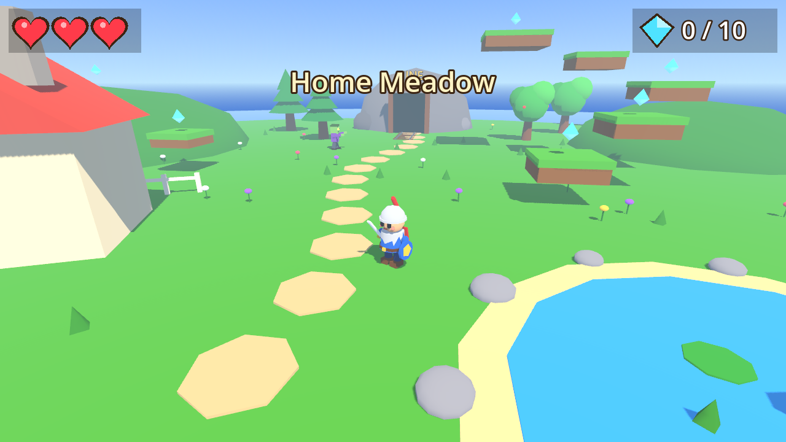
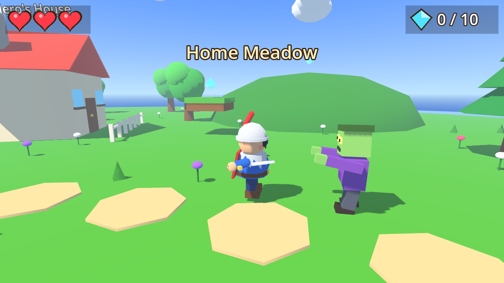
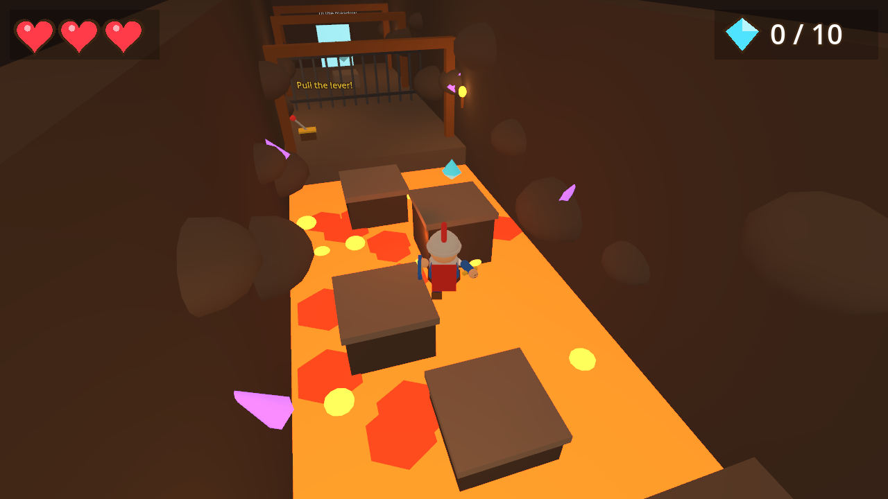

# Adventure World 3D (Phase 3 prototype)

A first 3D take on the game, made in **Godot 4.7**. It lives here in `godot/`, apart from the pygame game.
Everything you see is built from simple shapes in code (`scripts/`): no downloaded art or sounds.

## Play it
1. Install Godot once: `brew install --cask godot`
2. From the repo folder: `pixi run game3d` (or `godot --path godot`)
   - Start in the cave: `godot --path godot -- --cave`
   - Open it in the Godot editor: `godot --editor --path godot`

## Controls
| Key | What it does |
|---|---|
| Arrow keys | Run (you speed up and slow down a little) |
| SPACE | Jump. Press again in the air to double-jump (with a flip). Tap for a small hop |
| A or J, or left click | Swing the sword |
| Q / E, or drag with the right mouse button | Turn the camera. Mouse wheel zooms |

A is the attack key in the pygame game, so WASD isn't used for moving.

## What's in it
- **Home Meadow**: the Hero's house, trees, a pond, hills, floating grass blocks with diamonds, and the Mine.
- **A Zombie** shuffles in front of the Mine. It chases you when you're close. 3 sword hits or one jump on its head beats it; touching it costs a heart.
- **The Little Lava Cave** (through the Mine): hop the stepping stones over the lava, pull the lever (walk into it or hit it) to open the gate, grab the big diamond, and walk into the glowing door to go back out.
- **Hearts and diamonds** in the corners. Lava or falling off the world costs a heart and puts you back on safe ground. Out of hearts: back to the start with full hearts.

## Tests
- Loads with no script errors: `godot --headless --path godot --quit`
- Logic tests (diamonds, the Zombie's 3 hits and stomp, lava, falling, the lever and gate, the Mine, jumps, a robot that crosses the lava):
  `godot --headless --path godot res://tests/run_tests.tscn`
- Both run in `pixi run test` through `tests/test_godot_prototype.py`, which skips when `godot` isn't installed.

## Screenshots
`godot --path godot -- --shots` opens a window, saves `screenshots/*.png`, and quits.

## Files
- `scripts/main.gd`: sets up the Hero, the camera, the HUD, and the level; screenshot mode.
- `scripts/player.gd` (the Hero), `zombie.gd`, `camera_rig.gd`, `hud.gd`.
- `scripts/meadow.gd`, `cave.gd` (levels), with `diamond.gd`, `lever.gd`, `gate.gd`, `trigger.gd` (lava and doors).
- `scripts/game_state.gd` (autoload `Game`: hearts, diamonds), `sfx.gd` (autoload `Sfx`: made-up beeps), `build.gd` (shape helpers), `controls.gd` (keys).
